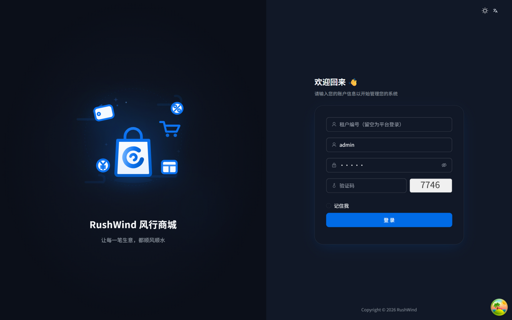
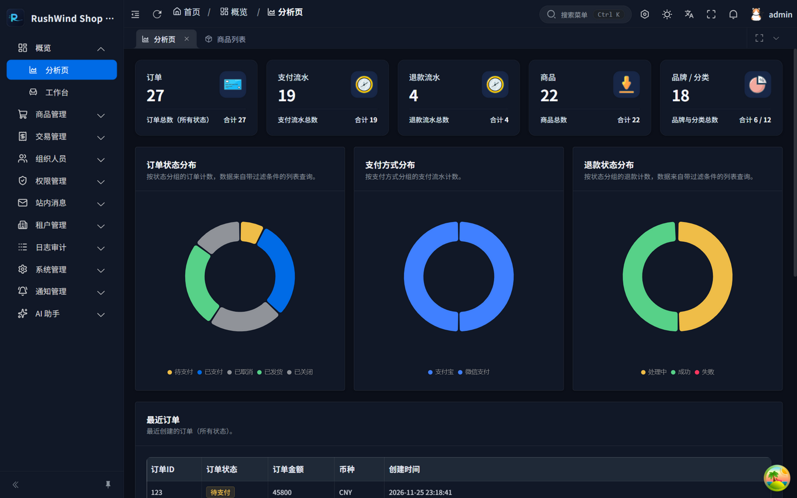
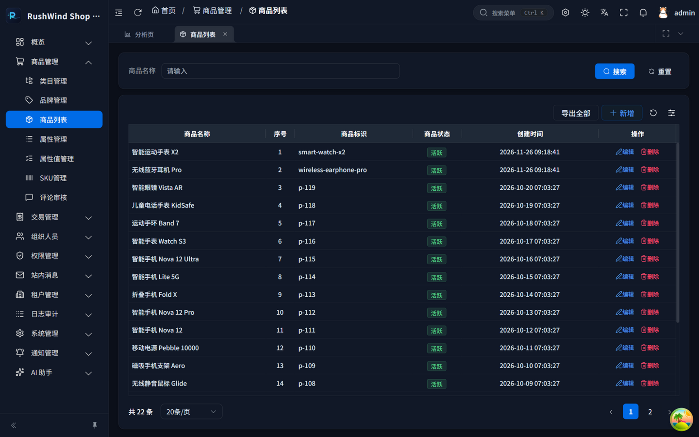
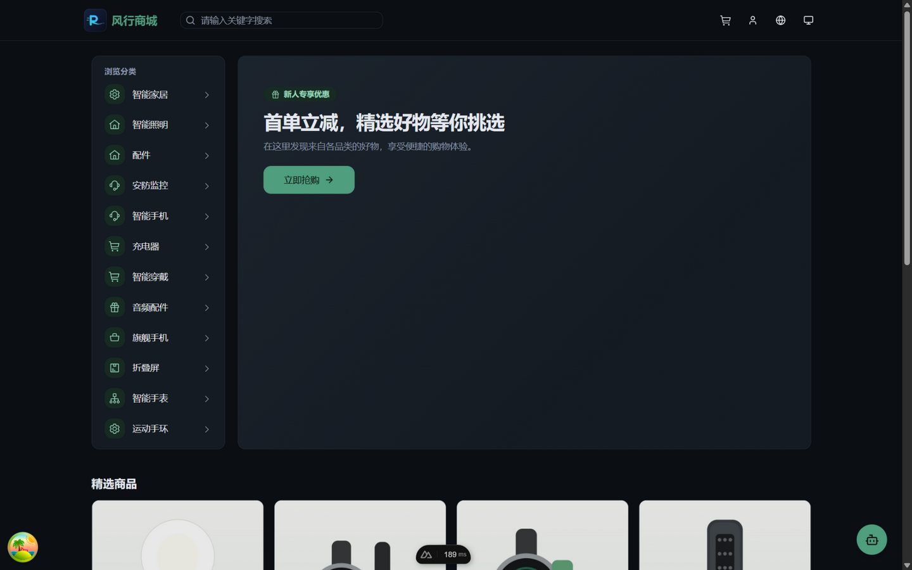
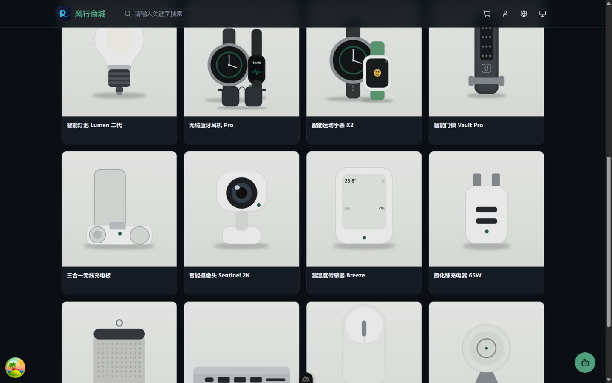
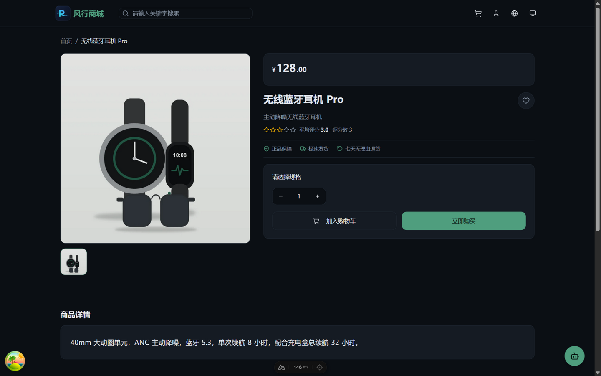
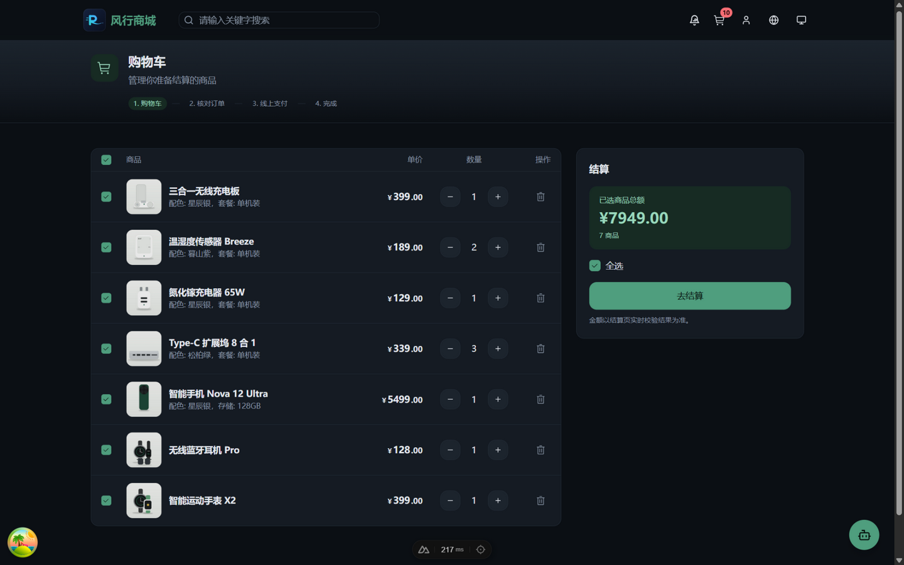
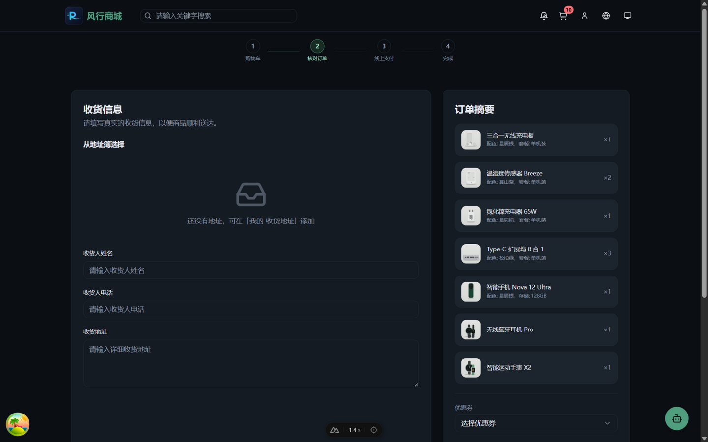
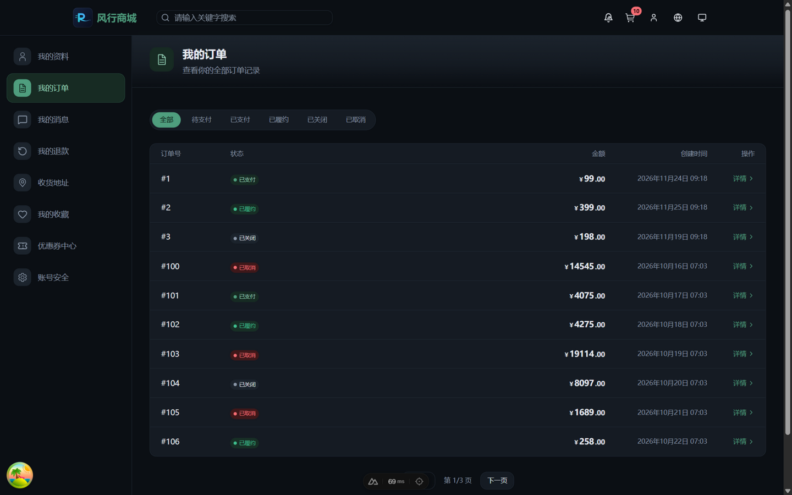

<div align="center">


# RushWind Shop｜风行商城

[](https://www.rust-lang.org/)
[](https://vuejs.org/)
[](https://nuxt.com/)
[](https://www.docker.com/)

</div>

---

## 项目简介

RushWind Shop（风行商城）是一套面向出海场景的企业级多语言电商平台，后端基于
[RushWind](https://github.com/tx7do/rushwind) Rust 微服务框架，采用
**Protobuf-first（契约驱动）** 工作流；前端后台基于 Vue 3 + TypeScript，店铺前台基于
Nuxt + Vue 3。

## 项目亮点

- **契约驱动（Protobuf-first）**：接口、数据模型、错误码均以 proto 为单一事实源；
  Rust 侧由 `rushwind-proto-build`（buf 编译）+ `rushwind-gen-http`（路由/绑定/trait/
  mount 生成）直接从契约生成 HTTP 面，由 tonic 生成域服务的 gRPC 面
- **三服务 BFF 架构**：`admin` / `app` 瘦网关 + `core` 核心实现，业务逻辑与传输层解耦
- **RushWind 全家桶装配**：authn-jwt + authn-gate（会话校验）、authz-rbac、
  SeaORM 存储（软删/缓存/观测装饰器）、Redis 缓存、apalis 异步任务、
  registry 服务发现、OpenTelemetry 链路追踪、SSE 推送
- **broker 引擎抽象**：订单/库存事件走 RushWind 的 14 引擎消息契约，
  开发环境 memory，生产环境一行配置切换 kafka/rabbitmq/…
- **双端前端**：管理后台（Vue 3 + Element Plus）与店铺前台（Nuxt）同仓共演进，全部走同一套契约生成的 TS 客户端
- **生产就绪**：JWT 鉴权、RBAC 授权、Docker 一键部署

## 功能总览

商城业务（`mall_*` 域）：

- **商品中心**：商品 / SKU / 类目 / 品牌 / 商品属性与属性值，全量携带 `zh-CN` / `en-US` 翻译表；
  评论与回复（含审核状态流转）
- **交易链路**：购物车 → 结算 → 订单（服务端计算总价，客户端金额仅为参考值）→ 支付流水 → 发货 / 签收，
  订单状态机拒绝非法迁移（如 `已支付 → 已取消` 直接拒绝）
- **营销与售后**：优惠券模板与领取、促销（专价 / 满减）、秒杀活动、拼团、积分账本、会员等级、
  退款流水、发票、税率、运费模板
- **库存**：SKU 库存与库存操作台账（下单扣减、告警规则）

用户侧：

- **账号**：注册（AES 加密信封传输）、登录、改密、忘记密码（邮箱验证码）、TOTP 两步验证
  （RFC 6238，密文落库，挑战原子消费防重放）
- **会员**：地址簿、收藏夹、会员等级（累计消费匹配档位）、积分签到与兑换、站内消息中心

平台侧：

- **权限**：多租户行级隔离、用户 / 角色 / 权限、登录策略（IP / 地区黑白名单）、登录审计
- **治理**：参数配置、字典、访问密钥（AK/SK 换取机器身份，常量时间摘要比对）、
  计划套餐与配额、异步任务、定时任务
- **扩展**：脚本引擎（Lua / JavaScript 沙箱，TestRun + 挂载点）、对象存储（S3 / MinIO，
  预签名上传下载，按请求桶名动态引擎）、服务器 / Redis 缓存监控
- **AI 助手**：OpenAI 兼容 Provider（云端模型或本地 Ollama）、AI 对话（SSE 流式落库）、
  商品文案生成、NL2SQL 问数（SELECT-only 围栏 + 行数上限）、AI Agent（图执行 + 人工审批门）、
  评价洞察摘要、Token 用量台账

> 诚实边界：支付通道当前内置模拟通道（无真实网关对接）；EMAIL / SMS / WEBHOOK 通知渠道仅落投递台账
> （需外部服务商）；知识库语义检索在嵌入运行时接入前降级为关键词匹配。仓库内的 Unimplemented 面
> 均以错误码如实应答，不假装成功。

## 界面预览

管理后台（Vue 3 + Element Plus，暗色主题）：

| 登录（品牌 + 图形验证码） | 分析页（实时指标 + 状态分布） |
| --- | --- |
|  |  |
| **商品列表（契约生成的 TS 客户端驱动）** | |
|  | |

店铺前台（Nuxt 3，多语言 + 暗色主题）：

| 首页（分类导航 + 精选商品） | 商品网格 | 商品详情（规格 / 评价洞察） |
| --- | --- | --- |
|  |  |  |
| **购物车（SKU 规格随行）** | **结算（地址 + 渠道 + 优惠券）** | **我的订单（全状态流转）** |
|  |  |  |

## 系统架构

```
HTTP/REST 请求
  └─ admin-service  (后台网关 BFF，REST:10600 / SSE:10601)
       └─ gRPC → core-service  (核心业务 + 数据落点)

app-service (前台网关 BFF，REST:10700) ──gRPC──→ core-service
core-service (gRPC，业务实现与数据访问)
```

| 服务 | 角色 | 是否访问 DB |
|------|------|:---:|
| `app/admin/service` | 后台网关 BFF（REST → gRPC 转发） | ❌ |
| `app/app/service` | 前台网关 BFF | ❌ |
| `app/core/service` | 核心业务实现（持久化、真实逻辑） | ✅ |

## 技术栈

| 层级 | 技术 |
|------|------|
| **后端框架** | `Rust` · `RushWind` · `Protobuf / Buf` · `tonic (gRPC)` |
| **ORM** | `SeaORM` · `PostgreSQL` · `MySQL` |
| **中间件** | `Redis` · `SeaweedFS`（S3 兼容对象存储）· `ElasticSearch / OpenSearch` · `etcd`（服务发现） |
| **认证授权** | `rushwind-authn-jwt`（JWT）· `rushwind-authn-gate`（会话白/黑名单）· `rushwind-authz-rbac` |
| **实时通信** | `SSE`（服务端推送）· `apalis-postgres`（异步任务） |
| **消息队列** | RushWind broker 契约（memory / kafka / rabbitmq / … 14 引擎） |
| **分布式** | `OpenTelemetry + Jaeger`（链路追踪） |
| **后台前端** | `Vue 3` · `TypeScript` · `Vite` · `Element Plus` |
| **店铺前端** | `Nuxt` · `Vue 3` · `TypeScript` · `Tailwind CSS` · `i18n` |
| **部署运维** | `Docker` · `Docker Compose` |

## 快速开始

### 环境要求

| 工具 | 版本 |
|------|------|
| Rust | 1.81+（stable 工具链） |
| buf | 1.50+（契约编译，PATH 可达） |
| Node.js | >= 20.10.0 |
| pnpm | >= 10.0.0 |
| Docker | 20.0+ |

> RushWind 框架以本地路径依赖接入（`../rushwind/crates/*`），构建前请确保
> rushwind 仓库与本仓库同级（或调整 `backend/Cargo.toml` 中的路径）。

### 启动中间件（推荐开发模式）

```bash
cd backend
docker compose -f docker-compose.libs.yaml up -d
```

### 初始化数据库（schema + 演示数据）

```bash
createdb rushwind_shop   # 或 psql -c "CREATE DATABASE rushwind_shop"
psql -d rushwind_shop -f backend/sql/schema.sql
psql -d rushwind_shop -f backend/sql/postgresql-demo-data.sql
```

演示数据包含 22 个商品（含 122 个 SKU 与中英文翻译）、6 品牌、12 类目、27 笔覆盖全状态的订单、
优惠券 / 促销 / 秒杀 / 评论 / 站内信等完整快照。首次启动 `core-service` 时自动执行
bootstrap（幂等）：建表、种入平台管理员与导航树。

### 演示账号

| 端 | 账号 | 密码 | 说明 |
|------|------|------|------|
| 管理后台 `:10300` | `admin` | `admin123` | 平台管理员（`sys:platform_admin`） |
| 店铺前台 `:3000` | `suxiaotong` / `chenyi` / `heyutong` / `linzhiyuan` | `admin123` | 演示顾客（购物车 / 订单 / 消息已预置） |

### 运行后端

```bash
cd backend
cargo run -p core-service    # 核心业务（gRPC）
cargo run -p admin-service   # 后台网关（REST :10600）
cargo run -p app-service     # 前台网关（REST :10700）
```

### 启动前端

```bash
cd frontend/admin && pnpm install && pnpm dev    # 管理后台
cd frontend/app && pnpm install && pnpm dev      # 店铺前台
```

## 仓库结构

```
rushwind-shop/
├── backend/               # Rust 工作区
│   ├── api/               # proto 契约（buf workspace，契约单一事实源）
│   ├── crates/proto/      # 契约 crate：buf → prost/pbjson 类型 + gen-http 路由面
│   ├── app/
│   │   ├── admin/service/ # 后台网关 BFF
│   │   ├── app/service/   # 前台网关 BFF
│   │   └── core/service/  # 核心业务（gRPC + SeaORM）
│   ├── pkg/               # 共享库（中间件装配、错误映射、配置）
│   └── sql/               # 数据库初始化与演示数据
├── frontend/              # 前端（契约生成的 TS 客户端驱动）
│   ├── admin/             # 管理后台（Vue 3 + Element Plus）
│   └── app/               # 店铺前台（Nuxt 3）
├── docs/                  # 文档与品牌资产
└── frontend/*/deploy/     # 各前端的 nginx 部署配置
```

## License

[MIT](./LICENSE)
